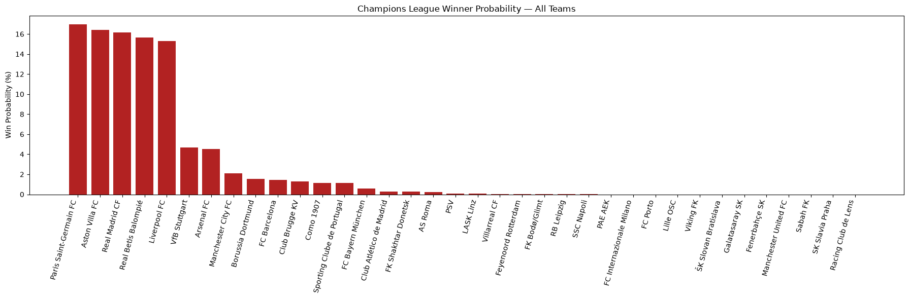
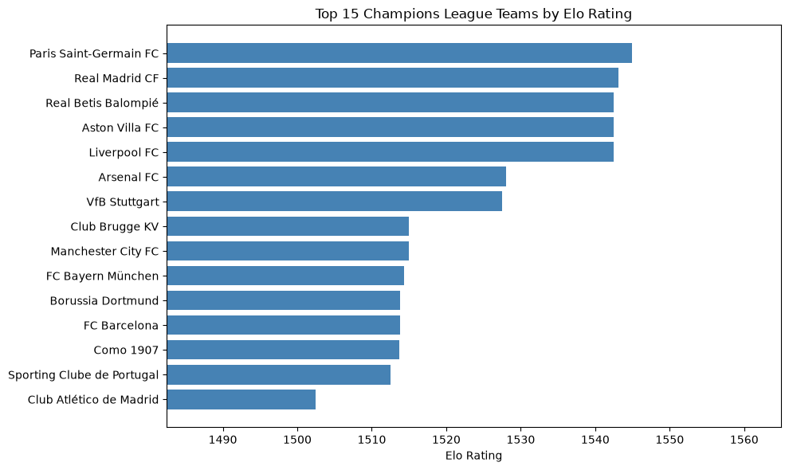

# Champions League Predictor

A Python tool that predicts Champions League outcomes using a self-updating Elo rating system, live match data, and Monte Carlo simulation.

## What it does

- **Live data:** pulls Champions League fixtures and results from the [football-data.org](https://www.football-data.org/) API
- **Elo rating engine:** builds team strength ratings from match results and corrects itself as new results come in
- **Form adjustment:** weights each team's last 5 results to capture hot and cold streaks
- **Bracket-aware simulation:** follows the current Champions League format, where the top 8 league-phase finishers go straight to the Round of 16, seeds 9–24 play a two-legged playoff, and the bottom 12 are eliminated
- **Tournament simulation:** runs the rest of the competition thousands of times to estimate each team's probability of winning the title
- **Live tracker:** re-fetches results periodically and recalculates predictions when a match finishes
- **Visualizations:** bar charts of team Elo ratings and title probabilities (matplotlib)

## Tech stack

Python, pandas, requests, scipy, matplotlib, python-dotenv, football-data.org API

## How it works

1. Fetches finished and upcoming matches for the current season
2. Builds Elo ratings for all 36 teams from completed matches
3. Simulates the rest of the league phase to project standings and seed the bracket
4. Simulates the knockout bracket thousands of times and counts how often each team wins
5. Polls for new results and reruns the pipeline automatically

## Setup

1. Clone this repo.
2. Install dependencies:
```
   pip install -r requirements.txt
```
3. Get a free API key from [football-data.org](https://www.football-data.org/client/register).
4. Create a file named `.env` in the project folder containing:
```
   FOOTBALL_DATA_API_KEY=your_key_here
```
5. Open `predict.ipynb` and run the cells in order.

## Notes

Early in the season, ratings are still close together, so title probabilities spread out. They sharpen as more matches are played.
## Example output

### Title probabilities



Simulated probability of each team winning the Champions League. The model projects the rest of the league phase, seeds the knockout bracket, and simulates the whole competition 5,000 times. Each bar shows how often a team won the title. Teams projected to miss the knockout rounds appear at 0%.

### Team strength

!

Current Elo ratings for the top 15 teams, built from completed match results. A team's rating rises when it beats expectations and falls when it underperforms, so the chart updates as new results come in.

Early in the season, ratings are still close together, so title probabilities are bunched and shift from run to run. They sharpen as more matches are played.
